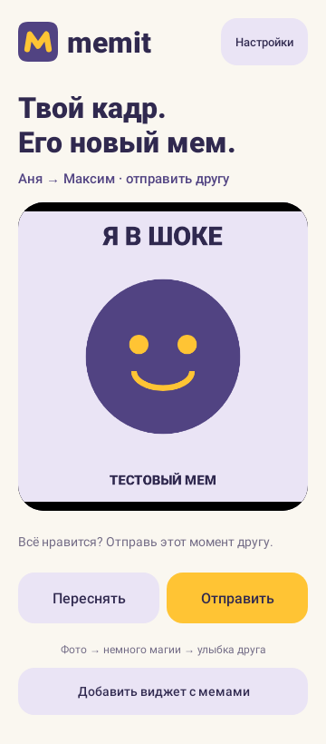
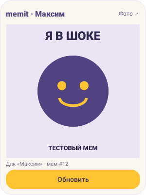

# Memit

**Твой кадр. Его новый мем.**

Memit — Android-приложение для обмена мемами с другом. Сделайте снимок, отправьте его — сервер обрежет фото до квадрата, добавит случайную надпись и фильтр. Получатель увидит готовый мем в виджете на рабочем столе.

Текущая версия: **0.2.0**. Это демоверсия для двух участников: **Аня** и **Максим**.

## Возможности

- Съёмка на основную или фронтальную камеру.
- Предпросмотр, пересъёмка и отправка фотографии другу.
- Настройка адреса сервера и проверка подключения.
- Виджет с последним входящим мемом и кнопкой «Обновить».
- Сохранение последнего мема на устройстве: картинка остаётся доступной без сети.
- Сохранение выбранного пользователя и адреса сервера между запусками.

## Как выглядит приложение

| Отправка фотографии | Виджет на рабочем столе |
|---|---|
|  |  |

На иллюстрациях используется тестовая картинка. Надпись и фильтр настоящего мема выбирает сервер после отправки.

## Установка

Для приложения нужен телефон с **Android 8.0 или новее** и доступ к работающему серверу Memit.

1. Получите APK у человека, который запускает сервер, или [соберите приложение из исходников](android/README.md).
2. Откройте APK на телефоне и установите Memit. При запросе Android разрешите установку из используемого источника.
3. Откройте приложение и перейдите в «Настройки».

Для подключения к локальному серверу по HTTP используйте **debug APK**. Release-сборка поддерживает только HTTPS.

## Первый запуск

1. Выберите пользователя: **Аня — ID 1** или **Максим — ID 2**. На втором устройстве выберите другого участника.
2. Введите адрес сервера, например `http://192.168.1.10:8080/`. Адрес нужно получить у человека, который запустил сервер.
3. Нажмите «Проверить подключение». При успешной проверке нажмите «Сохранить».
4. Разрешите доступ к камере, когда будете готовы сделать снимок.

Приложение и все его виджеты на одном устройстве используют общего пользователя и один адрес сервера. Получателем автоматически становится второй участник.

## Как отправить мем

1. Наведите камеру и нажмите «Сделать снимок».
2. Проверьте фотографию в предпросмотре. При необходимости нажмите «Переснять».
3. Нажмите «Отправить» и дождитесь сообщения об успешной отправке.
4. Попросите друга нажать «Обновить» в своём виджете.

Во время отправки повторное нажатие блокируется. Если запрос завершился ошибкой, снимок остаётся в предпросмотре: его можно отправить повторно или переснять.

## Как добавить виджет

Нажмите «Добавить виджет с мемами» в приложении и подтвердите добавление. Если рабочий стол не поддерживает добавление из приложения, зажмите свободное место на нём, откройте список виджетов и выберите Memit.

При добавлении виджет загружает последний входящий мем. Чтобы получить следующий, нажмите **«Обновить»**. Размер виджета можно изменить средствами рабочего стола. Изображение показывается целиком, без обрезки надписи.

Если фотографий ещё нет, появится «Пока нет мемов». При потере сети виджет сохранит последнюю загруженную картинку; после восстановления связи нажмите «Обновить» ещё раз.

## Подключение к серверу

| Способ подключения | Адрес в приложении |
|---|---|
| Телефон и сервер в одной Wi-Fi сети | `http://<IP-компьютера>:8080/` |
| Телефон по USB с настроенным `adb reverse` | `http://127.0.0.1:8080/` |
| Android Studio Emulator, сервер на том же компьютере | `http://10.0.2.2:8080/` |

Укажите адрес корня сервера без `/api`. Для локального подключения компьютер с сервером должен оставаться включённым. Настройка сервера и USB-подключения описана в [руководстве сервера](backend/README.md).

## Если что-то не работает

| Проблема | Что проверить |
|---|---|
| Сервер недоступен | Адрес в настройках, запуск сервера, сеть и доступность порта 8080. Для Wi-Fi устройства должны находиться в одной доступной сети. |
| Камера не открывается | Разрешите камеру в настройках Android для Memit. Закройте другие приложения, использующие камеру, и повторите. |
| Мем не появился у друга | Убедитесь, что выбраны разные участники и один сервер. Нажмите «Обновить» в виджете получателя. |
| После переподключения USB нет связи | Повторите `adb reverse`, как описано в инструкции сервера. |
| В виджете остаётся старая картинка | Проверьте подключение и нажмите «Обновить». При ошибке виджет намеренно сохраняет предыдущий мем. |

## Особенности демоверсии

Входа по паролю и регистрации пока нет: используются два общих демопрофиля. Новые фото появляются в виджете после ручного обновления; push-уведомления не предусмотрены. Для получения новых мемов сервер должен быть доступен устройству.

## Документация

- [Сборка Android-приложения](android/README.md)
- [Запуск и настройка сервера](backend/README.md)
- [API](docs/API.md)
- [Тестирование](docs/ANDROID_VERIFICATION.md)
- [Дизайн](design/README.md)
- [Изменения версий](CHANGELOG.md)
